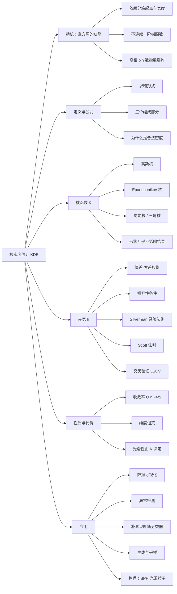

# 核密度估计

> **Kernel Density Estimation (KDE)** —— 非参数密度估计方法。给定样本，不假设 $f$ 属于任何参数族，直接还原背后的概率密度函数。

## 知识图谱

---

## 一、动机：直方图的两个缺陷

最朴素的经验密度是**直方图**：把轴切成等宽的箱，数每箱的点数，除以 $n\times$ 箱宽。

它有两个绕不过去的毛病：

| 缺陷 | 说明 |
|------|------|
| **依赖分箱方式** | 同一批数据，起点挪半个箱宽，图形就变了 —— 这是**人为假结构**，不是数据里的 |
| **不连续** | 输出是阶梯函数，而真实密度通常光滑 |
| （高维） | $d$ 维切 $m$ 段，箱数是 $m^d$，**指数爆炸** |

KDE 的思路：**别硬数，改成"摊开"** —— 每个点不只投给它所在的箱，而是向两边平滑地"渗"出去。

---

## 二、定义与公式

### 2.1 公式

设样本 $x_1, x_2, \dots, x_n$，核函数 $K$，带宽 $h > 0$，则密度估计为

$$\hat f_h(x) = \frac{1}{nh}\sum_{i=1}^{n} K\!\left(\frac{x - x_i}{h}\right)$$

### 2.2 三个组成部分

| 符号 | 名称 | 作用 |
|------|------|------|
| $K(\cdot)$ | **核函数** | 对称、积分为 1 的概率密度（常用高斯核） |
| $h$ | **带宽** | 控制每个核多"胖"，即平滑程度 |
| $n$ | 样本量 | 归一化 |

> 💡 **一句话直觉**
> 在**每个数据点 $x_i$ 上放一个小山丘**（核），把所有山丘**加起来**，再除以 $n$ —— 得到的就是密度估计。

与直方图的对照：直方图是"每个点往一个箱子里投一票"，KDE 是"每个点往周围一片区域投票，越近权重越大"。

### 2.3 为什么它确实是密度

**非负性**：$K \geq 0 \Rightarrow \hat f_h(x) \geq 0$

**规范性**（换元 $u = \dfrac{x - x_i}{h}$，$dx = h\,du$）：

$$\int_{-\infty}^{\infty}\hat f_h(x)\,dx = \frac{1}{nh}\sum_{i=1}^{n}\int_{-\infty}^{\infty}K\!\left(\frac{x-x_i}{h}\right)dx = \frac{1}{nh}\cdot n \cdot h = 1$$

两个条件都满足，所以 $\hat f_h$ 是合法的概率密度。

---

## 三、核函数 $K$

### 3.1 常见核函数

| 名称 | 表达式 | 支撑 |
|------|--------|------|
| **高斯核** | $K(u) = \dfrac{1}{\sqrt{2\pi}}e^{-u^2/2}$ | $(-\infty, \infty)$ |
| **Epanechnikov 核** | $K(u) = \dfrac{3}{4}(1-u^2)$ | $\lvert u \rvert \leq 1$ |
| **均匀核** | $K(u) = \dfrac{1}{2}$ | $\lvert u \rvert \leq 1$ |
| **三角核** | $K(u) = 1 - \lvert u \rvert$ | $\lvert u \rvert \leq 1$ |

### 3.2 核函数的选择并不重要

只要 $K$ 对称、光滑、积分为 1，换成上面任意一种，结果差别都很小。

- 理论最优是 **Epanechnikov 核**（在最小化 MISE 的意义下）；
- 但**高斯核**与它的差距小到实践中可忽略，且高斯核处处光滑、求导方便，所以最常用。

> ⚠️ **结论：调 $h$ 的收益远大于挑 $K$。**

---

## 四、带宽 $h$ —— 全部难点所在

### 4.1 偏差-方差权衡

| $h$ | 现象 | 术语 |
|-----|------|------|
| **太小** | 每个核又尖又窄，估出来是 $n$ 个孤立尖峰 —— **在描述数据，不是描述分布** | 过拟合，方差大 |
| **太大** | 过度平滑，真实结构被抹平 —— **双峰会被抹成单峰** | 欠拟合，偏差大 |

### 4.2 相容性条件

$$h \to 0, \qquad nh \to \infty \quad (n \to \infty)$$

即"核要越来越窄，但总的有效样本量要趋于无穷"。

### 4.3 常用的选取方法

| 方法 | 公式 / 做法 | 特点 |
|------|------------|------|
| **Silverman 经验法则** | $h = 1.06\,\hat\sigma n^{-1/5}$，其中 $\hat\sigma = \min\!\left(s,\ \dfrac{\mathrm{IQR}}{1.34}\right)$ | 快；假定接近正态，**多峰数据会偏大** |
| **Scott 法则** | $h = 3.49\,s\,n^{-1/5}$ | 同上思路 |
| **交叉验证（LSCV）** | 最小化估计的积分平方误差 | 更可靠，但要算 |

---

## 五、性质与代价

### 5.1 收敛速度

均方误差的最优收敛率为

$$O\!\left(n^{-4/5}\right)$$

而参数估计（如直接估 $\mu, \sigma$）是 $O(n^{-1})$。

> 💡 **非参数方法的代价**：收敛更慢。因为你没有用"它一定是正态"这类先验信息来帮忙。

### 5.2 维度诅咒

$d$ 维时收敛率为

$$O\!\left(n^{-\frac{4}{4+d}}\right)$$

$d$ 一大，指数趋近于 0，几乎不收敛。高维要另想办法：自适应带宽、变量选择、先降维再估计。

### 5.3 光滑性

$\hat f_h$ 的光滑程度由 $K$ 决定：核 $m$ 阶可导 $\Rightarrow$ 估计 $m$ 阶可导。这是 KDE 相对直方图的核心优势。

---

## 六、与其他密度估计方法对比

| 方法 | 是否假设分布形式 | 输出形态 | 主要缺点 |
|------|----------------|---------|---------|
| 参数估计（MLE 拟合正态） | ✅ 假定 | 几个参数 | 假设错了就全错 |
| 直方图 | ❌ | 阶梯 | 依赖分箱、不连续 |
| **核密度估计** | ❌ | 光滑 | 要选带宽、高维失效 |
| k 近邻密度估计 | ❌ | 不光滑但自适应 | 密度不均时表现怪 |

---

## 七、典型应用

| 场景 | 说明 |
|------|------|
| **数据可视化** | 小提琴图、山脊图（ridgeline）、`seaborn.kdeplot` |
| **异常检测** | 密度低于某阈值 $\Rightarrow$ 可疑点 |
| **分类器** | 朴素贝叶斯中用 KDE 代替"每类都是高斯"的假设 |
| **生成 / 采样** | 从 KDE 采样 = 随机挑一个样本点，再加一个按核分布的噪声 |
| **物理** | **光滑粒子流体动力学（SPH）** 把离散粒子平滑成连续场，用的是同一套核估计 |

---

## 八、具体例子

数据 $x = \{1,\ 2,\ 2.5,\ 4\}$，高斯核。取不同带宽：

$$\hat f_h(x) = \frac{1}{4h}\sum_{i=1}^{4}\frac{1}{\sqrt{2\pi}}e^{-\frac{1}{2}\left(\frac{x-x_i}{h}\right)^2}$$

| $x$ | $h=0.5$ | $h=1.0$ | $h=2.0$ |
|-----|---------|---------|---------|
| 1.00 | 0.2287 | 0.1937 | 0.1477 |
| 1.50 | 0.2690 | 0.2409 | 0.1635 |
| 2.00 | 0.3475 | 0.2617 | 0.1725 |
| 2.25 | **0.3613** | 0.2606 | 0.1740 |
| 2.50 | 0.3249 | 0.2525 | 0.1735 |
| 3.00 | 0.1750 | 0.2225 | 0.1666 |
| 3.50 | 0.1502 | 0.1853 | 0.1528 |
| 4.00 | **0.2018** | 0.1467 | 0.1339 |

**读法**：

- $h = 0.5$：四个山丘分别立在 $1,\ 2,\ 2.5,\ 4$。其中 $2$ 与 $2.5$ 只隔 $0.5$，而核宽也是 $0.5$，**大幅重叠**合成一个鼓包（峰值在 $2.25$，$0.3613$）；$4$ 孤立，是单独的小峰（$0.2018$）。
- $h = 2.0$：数值被压到 $0.13 \sim 0.17$ 一条窄带里 —— **全部结构被抹平**，这就是"带宽太大"的直观样子。

> 校验：对 $h = 0.5$ 的曲线在 $[-5, 10]$ 上数值积分得 $1.000000$ ✓ 与 §2.3 的规范性一致。

---

## ⚠️ 易混淆辨析

| 概念 | 正确含义 | 错误说法 |
|------|---------|---------|
| **核函数 $K$ vs 带宽 $h$** | $h$ 决定平滑程度，是**唯一需要认真调**的参数；$K$ 的形状影响极小 | ❌ 以为换个核函数能显著改善结果 |
| **非参数** | 指**不假定 $f$ 的参数形式**，不是说"没有参数" | ❌ 非参数 = 没有参数 |
| **$h \to 0$** | 单独让 $h \to 0$ 会得到一堆尖峰，**不是**更好的估计 | ❌ 带宽越小越精确 |
| **$O(n^{-4/5})$** | 这是**密度估计**的最优速率，比参数估计的 $O(n^{-1})$ 慢 | ❌ 以为非参数方法更"强"所以收敛更快 |
| **KDE vs 直方图** | 两者都是经验密度，KDE 只是把硬计数换成平滑核 | ❌ 以为 KDE 是完全不同类别的东西 |

---

## 常用公式汇总

| 项目 | 公式 |
|------|------|
| KDE 定义 | $\hat f_h(x) = \dfrac{1}{nh}\sum\limits_{i=1}^{n} K\!\left(\dfrac{x-x_i}{h}\right)$ |
| 高斯核 | $K(u) = \dfrac{1}{\sqrt{2\pi}}e^{-u^2/2}$ |
| Epanechnikov 核 | $K(u) = \dfrac{3}{4}(1-u^2),\ \lvert u \rvert \leq 1$ |
| 规范性验证 | $\int \hat f_h(x)\,dx = 1$ |
| 相容性条件 | $h \to 0,\ nh \to \infty$ |
| Silverman 法则 | $h = 1.06\,\hat\sigma n^{-1/5}$ |
| 收敛率（1 维） | $O\!\left(n^{-4/5}\right)$ |
| 收敛率（$d$ 维） | $O\!\left(n^{-\frac{4}{4+d}}\right)$ |

---

## 关联笔记

- [[随机事件与概率]] —— 概率基础概念与公式总览（KDE 属于"从样本反推分布"的估计问题，是概率论的下游应用）
