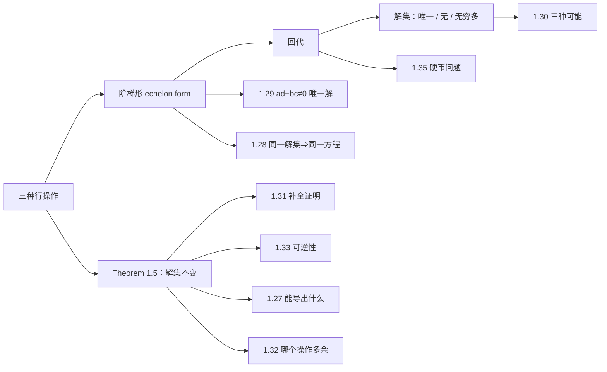

# Gauss's Method 习题详解（1.27–1.35）· L0 课本口径

> **阶段**：Hefferon §I「Gauss's Method」—— 矩阵、秩、行空间、零空间、初等矩阵、行列式判别**全部未学**，本篇一律不用。
> **工具**：array 写法 + 三种行操作（$\rho_i\leftrightarrow\rho_j$、$c\rho_i$、$\rho_i+c\rho_j$，$c\neq0$）→ 阶梯形 → 回代 → 自由变量参数化。

## 知识图谱

---

## 前置：本阶段口径

**会用**
- 把方程写成 array；行操作记 $\rho_i\leftrightarrow\rho_j$、$c\rho_i$、$\rho_i+c\rho_j$
- 化到**阶梯形**（每行首个非零系数逐列右移）→ 回代
- 有无穷多解时把**自由变量**当参数，解集写成集合形式

**不会用（写了就是超纲）**
矩阵 $A$、$Ax=b$、秩、行空间、零空间、仿射解集、初等矩阵、$\det$ 判别、Cramer

**三栏卡（现阶段版）**：进度文件里要求"几何 / 矩阵 / 方程组"三栏，但矩阵语言还没学，所以暂用
**几何画面 ｜ 方程语言（array + ρ）｜ 解集**
等第三章学了矩阵再把中间那栏补上。

---

## 1. 1.27

> Gauss's Method works by combining the equations in a system to make new equations.

**总判据**（由 Theorem 1.5 直接得到）：合法操作产生的每个新方程，都会被原方程组的**每一个解**满足。所以"能不能导出"先看解。

### (a) $3x-2y=5$？—— 能，一步

$$\begin{array}{*{2}{rc}r}x&+&y&=&1\\4x&-&y&=&6\end{array}\ \xrightarrow{\ -\rho_1+\rho_2\ }\ \begin{array}{*{2}{rc}r}x&+&y&=&1\\3x&-&2y&=&5\end{array}$$

即"第二式 − 第一式"，正是合法操作，直接得到目标方程。✓

**三栏卡**
- 几何：原方程组两直线交于 $(\tfrac75,-\tfrac25)$；新方程是过同一点的另一条直线。
- 方程：$\rho_2\leftarrow\rho_2-\rho_1$。
- 解集：原系统解集不变，仍是 $\{(\tfrac75,-\tfrac25)\}$；新方程只是把这个解"换了个写法"。

### (b) $5x-3y=2$？—— 不能

先把原系统解出来（它是唯一解的情形）：

$$\begin{array}{*{2}{rc}r}2x&+&2y&=&5\\3x&+&y&=&4\end{array}\ \xrightarrow{\ -\frac32\rho_1+\rho_2\ }\ \begin{array}{*{2}{rc}r}2x&+&2y&=&5\\ & &-2y&=&-\frac72\end{array}\ \xrightarrow{\ -\frac12\rho_2\ }\ \begin{array}{*{2}{rc}r}2x&+&2y&=&5\\ & &y&=&\frac74\end{array}$$

回代：$2x+2\cdot\tfrac74=5\Rightarrow2x=\tfrac32\Rightarrow x=\tfrac34$。解集 $\{(\tfrac34,\tfrac74)\}$。

合法导出的方程必须被每个解满足，但
$$5\cdot\tfrac34-3\cdot\tfrac74=\tfrac{15-21}{4}=-\tfrac32\neq2$$
目标方程不被唯一解满足 ⇒ **导不出**。✓

**换算法验证**（设目标 = 第一式$\times p$ + 第二式$\times q$）：
$$2p+3q=5,\quad 2p+q=-3,\quad 5p+4q=2$$
前两式给 $q=4,\ p=-\tfrac72$，代入第三式：$5(-\tfrac72)+4\cdot4=-\tfrac32\neq2$，矛盾。

**三栏卡**
- 几何：两直线交于 $(\tfrac34,\tfrac74)$，而 $5x-3y=2$ 不过该点。
- 方程：消元得唯一解；目标方程代不进去。
- 解集：推导不丢解 ⇒ 不过解集的方程不可能被导出。

### (c) $6x-9y+5z=-2$？—— 能，两步

先找组合：$-3\times$第一式 $+\ 2\times$第二式
$$-3(2x+y-z=4)+2(6x-3y+z=5)\ \Longrightarrow\ 6x-9y+5z=-2$$
系数、常数都对上 ✓。用合法操作实现：

$$\begin{array}{*{3}{rc}r}2x&+&y&-&z&=&4\\6x&-&3y&+&z&=&5\end{array}\ \xrightarrow{\ 2\rho_2\ }\ \begin{array}{*{3}{rc}r}2x&+&y&-&z&=&4\\12x&-&6y&+&2z&=&10\end{array}\ \xrightarrow{\ -3\rho_1+\rho_2\ }\ \begin{array}{*{3}{rc}r}2x&+&y&-&z&=&4\\6x&-&9y&+&5z&=&-2\end{array}$$

**自检**（新方程确实被原解集满足）：原两式相加得 $8x-2y=9$；取 $y=0$，则 $x=\tfrac98$，$z=2x+y-4=-\tfrac74$。代入：$6\cdot\tfrac98+5\cdot(-\tfrac74)=\tfrac{27}{4}-\tfrac{35}{4}=-2$ ✓

**三栏卡**
- 几何：$\mathbb R^3$ 中两平面交成一条直线；新方程是第三个平面，且包含这条交线。
- 方程：$2\rho_2$ 再 $-3\rho_1+\rho_2$。
- 解集：三个方程的解集仍是原来那条直线。

> (b) 与 (c) 的分寸：唯一解时"不过该点"即可否证；无穷多解时必须真的找出组合系数。

---

## 2. 1.28

> Prove that, where $a,b,\ldots,e$ are real numbers and $a\neq0$, if $ax+by=c$ and $ax+dy=e$ have the same solution set then they are the same equation. What if $a=0$?

**证明（$a\neq0$）**

1. $a\neq0$ ⇒ 第一式解集无限：任取 $y$，$x=\dfrac{c-by}{a}$ 就是一个解。
2. 两式解集相同 ⇒ 相减得到的 $(b-d)y=c-e$ 对解集中每一点成立。
3. 若 $b\neq d$，则 $y=\dfrac{c-e}{b-d}$ 只能取一个值；再由 $a\neq0$，$x=\dfrac{c-by}{a}$ 也只能取一个值 ⇒ 解集至多一个点，与第 1 步矛盾。
4. 故 $b=d$。此时两式左端相同；解集非空（第 1 步），取其中一点代入两式即得 $c=e$。∎

**若 $a=0$，命题为假**

- $0x+y=1$ 与 $0x+2y=2$：解集同为 $\{(x,1):x\in\mathbb R\}$，方程不同（差一个非零倍数）。
- $0x+0y=1$ 与 $0x+0y=2$：解集同为 $\varnothing$，方程不同。

$a\neq0$ 的作用：两式被**规范化到同一个 $x$ 系数**，"同一条直线"才被迫退化成"同一个方程"。

**三栏卡**
- 几何：$a\neq0$ 的直线不水平（与每条水平线恰交一次）；两条不水平的直线若解集相同必为同一条，而 $x$ 系数已被钉成同一个 $a$，故完全重合。
- 方程：相减消掉 $x$，只剩 $y$；$y$ 被钉死 ⇒ 与无限解矛盾。
- 解集：同解 ⇒ 同方程（在 $a\neq0$ 的规范化下）。

---

## 3. 1.29

> Show that if $ad-bc\neq0$ then $\begin{array}{r}ax+by=j\\ cx+dy=k\end{array}$ has a unique solution.

**证明**：分两种情况消元，两种情况都得到一个"每个主元都非零"的阶梯形。

**情况 1：$a\neq0$**。用第一式消去第二式的 $x$：

$$\begin{array}{*{2}{rc}r}ax&+&by&=&j\\cx&+&dy&=&k\end{array}\ \xrightarrow{\ -\frac ca\rho_1+\rho_2\ }\ \begin{array}{*{2}{rc}r}ax&+&by&=&j\\ & &\frac{ad-bc}{a}\,y&=&\frac{ak-cj}{a}\end{array}$$

$ad-bc\neq0$ 且 $a\neq0$ ⇒ 第二式系数非零 ⇒ $y=\dfrac{ak-cj}{ad-bc}$ 唯一；代回第一式（$a\neq0$）⇒ $x$ 唯一。

**情况 2：$a=0$**。此时 $ad-bc=-bc\neq0$ ⇒ $b\neq0$ 且 $c\neq0$。第一式直接给 $y=\dfrac jb$（唯一）；代入第二式，$c\neq0$ ⇒ $x=\dfrac{k-dj/b}{c}$（唯一）。

两种情况都得唯一解。∎

（回代显式结果：$y=\dfrac{ak-cj}{ad-bc}$，$x=\dfrac{dj-bk}{ad-bc}$，可代回原方程组检验。）

**三栏卡**
- 几何：$ad-bc\neq0$ ⇒ 两直线不平行 ⇒ 恰交于一点。（$ad-bc=0$ 时两直线平行：重合则无穷多解，相离则无解。）
- 方程：消元后两个主元都非零，能一路回代到底，没有自由变量。
- 解集：恰好一个点。

---

## 4. 1.30

> In the system each of the equations describes a line in the $xy$-plane. By geometrical reasoning, show that there are three possibilities: a unique solution, no solution, and infinitely many solutions.

**几何推理**

系数不全为 0 时，$ax+by=c$ 的解集是 $xy$ 平面上的**一条直线**。平面内两条直线只有三种位置关系：

| 位置关系 | 解集 |
|---|---|
| 相交于一点 | **唯一解** |
| 平行且不重合 | **无解** |
| 完全重合 | **无穷多解**（整条直线） |

除此之外没有第四种可能——两条直线不可能"交于两点"或"交于一段"。

**代数对应**（与 1.29 衔接）
- $ad-bc\neq0$：不平行 ⇒ 唯一解；
- $ad-bc=0$：平行 ⇒ 再看常数项是否同比例：同比例 ⇒ 重合（无穷多解）；不同比例 ⇒ 相离（无解）。

**退化备注**：若某式系数全为 0（$0x+0y=c$），则 $c\neq0$ 时无解、$c=0$ 时该式不约束任何点——仍落在上面三类里。

**三栏卡**
- 几何：相交 / 平行不重合 / 重合。
- 方程：$ad-bc\neq0$ 唯一；$=0$ 时看常数项比例。
- 解集：一个点 / 空集 / 一条直线。

---

## 5. 1.31

> Finish the proof of Theorem 1.5.

**Theorem 1.5（Gauss's Method）**：方程组经三种操作之一变成新方程组，则两个方程组解集相同。

书中已完成：换行、数乘显然成立；"相加"操作已证**旧解必是新解**（新方程是旧方程的组合，把旧解代进去两边仍相等）。

**要补的：新解也是旧解。**

**证明**：设 $S_1$ 经"把第 $k$ 式换成 （第 $k$ 式）$+\,c\,\times$（第 $i$ 式）"变成 $S_2$。对 $S_2$ 施行**反向操作**：把第 $k$ 式换成 （第 $k$ 式）$-\,c\,\times$（第 $i$ 式）。

- 这仍是同一种合法操作（加另一式的倍数）；
- 第 $i$ 式两步之间没有变，所以减掉 $c$ 倍的第 $i$ 式后，第 $k$ 式精确还原 ⇒ 系统回到 $S_1$。

设 $\mathbf x$ 是 $S_2$ 的解。把已证的方向用在"$S_2\to S_1$"这一步上（前系统的解是后系统的解），$\mathbf x$ 就是 $S_1$ 的解。∎

> 一句话：**每个操作的逆仍是合法操作**，所以"$\Rightarrow$"能反着再走一遍——这正是 1.33 的内容。

**三栏卡**
- 几何：行操作只是把同一个点集换一种写法，不碰点集本身。
- 方程：反向操作的系数是 $-c$（数乘是 $c^{-1}$，换行是它自己）。
- 解集：$\operatorname{sol}(S_1)=\operatorname{sol}(S_2)$。

---

## 6. 1.32

> Is any of the operations used in Gauss's Method redundant? That is, can we make any of the operations from a combination of the others?

**答：有——换行（swap）多余；数乘与相加不可省。**

### swap 可拼出

以交换第 1、2 式为例，四步全是合法操作：

| 步骤 | 操作 | 两式变为 |
|---|---|---|
| 1 | $\rho_1\leftarrow\rho_1+\rho_2$ | $(R_1+R_2,\ R_2)$ |
| 2 | $\rho_2\leftarrow\rho_2-\rho_1$ | $(R_1+R_2,\ -R_1)$ |
| 3 | $\rho_1\leftarrow\rho_1+\rho_2$ | $(R_2,\ -R_1)$ |
| 4 | $\rho_2\leftarrow-\rho_2$ | $(R_2,\ R_1)$ ✓ |

交换第 $i,j$ 式同理（把 1、2 换成 $i,j$）。

### 数乘不可省

考虑只有一个方程的系统 $\{x=1\}$：换行没有效果；"加**另一式**的倍数"需要存在另一式，无法施行 ⇒ 只用换行与相加，系统永远停在 $\{x=1\}$，得不到 $\{2x=2\}$。

（若允许"加自己的倍数"，数乘就可省了；但 Gauss's method 的操作定义写的是"另一条"方程。）

### 相加不可省

考虑 $\begin{array}{r}x=1\\y=1\end{array}$。只用换行和数乘，每条方程始终只是 $x=1$ 或 $y=1$ 的某个非零倍数（只含一个变量）⇒ 永远得不到 $x+y=2$（同时含两个变量）。

**三栏卡**
- 几何：换行只是"重新编号"，不产生新方程；相加能产生真正的新方程（过解集的另一条直线）。
- 方程：上面的构造 + 两个反例。
- 解集：三种操作都不改变解集，但生成新方程的能力不同。

---

## 7. 1.33

> Prove that each operation of Gauss's Method is reversible. That is, show that if two systems are related by a row operation $S_1\to S_2$ then there is a row operation to go back $S_2\to S_1$.

| 操作 $S_1\to S_2$ | 逆操作 $S_2\to S_1$ | 为何仍是合法操作 |
|---|---|---|
| $\rho_i\leftrightarrow\rho_j$ | 再交换一次 | 换行 |
| $\rho_i\leftarrow c\rho_i\ (c\neq0)$ | $\rho_i\leftarrow c^{-1}\rho_i$ | $c^{-1}\neq0$，数乘 |
| $\rho_k\leftarrow\rho_k+c\rho_i$ | $\rho_k\leftarrow\rho_k-c\rho_i$ | 加 $-c$ 倍，仍是"加另一式的倍数" |

**证明**：施行逆操作后，被改过的那条方程精确还原（其余方程从未被动）⇒ 系统回到 $S_1$。∎

> 这是 1.31 的引擎：正向、反向都合法，所以解集在两个方向上都互相包含。

**三栏卡**
- 几何：每种操作都是可撤销的动作（换回去 / 缩回去 / 减回去）。
- 方程：逆操作的系数分别是 $1$、$c^{-1}$、$-c$。
- 解集：$S_1\to S_2\to S_1$，解集自始至终不变。

---

## 8. 1.35

> [Anton] A box holding pennies, nickels and dimes contains thirteen coins with a total value of 83 cents. How many coins of each type are in the box? (penny = 1 cent, nickel = 5 cents, dime = 10 cents.)

设 $p,n,d$ 为便士、五分、十分的个数：

$$\begin{array}{*{3}{rc}r}p&+&n&+&d&=&13\\p&+&5n&+&10d&=&83\end{array}\ \xrightarrow{\ -\rho_1+\rho_2\ }\ \begin{array}{*{3}{rc}r}p&+&n&+&d&=&13\\ & &4n&+&9d&=&70\end{array}$$

两个方程、三个未知量 ⇒ 有一个**自由变量**。取 $d$ 为参数：
$$n=\frac{70-9d}{4},\qquad p=13-n-d=\frac{5d-18}{4}$$

硬币数必须是**非负整数**，于是：

| 约束 | 推论 |
|---|---|
| $4n=70-9d\ge0$ | $d\le 7$ |
| $p=\frac{5d-18}{4}\ge0$ | $d\ge \frac{18}{5}=3.6$ |
| $n\in\mathbb Z$ | $70-9d\equiv0\pmod4\Rightarrow 2-d\equiv0\Rightarrow d\equiv2\pmod4$ |
| $p\in\mathbb Z$ | $5d-18\equiv d-2\equiv0\pmod4$（同上，两条件不独立） |

在 $3.6\le d\le7$ 中满足 $d\equiv2\pmod4$ 的只有 $d=6$：
$$n=\frac{70-54}{4}=4,\qquad p=\frac{30-18}{4}=3$$

**检验**：$3+4+6=13$ 枚 ✓；$3\cdot1+4\cdot5+6\cdot10=83$ 分 ✓

**答：便士 3 枚、五分 4 枚、十分 6 枚。**

**三栏卡**
- 几何：$\mathbb R^3$ 中两平面的交线；"整数 + 非负"在直线上只挑出一个格点。
- 方程：消去 $p$ 得 $4n+9d=70$，$d$ 自由。
- 解集：$\{(\tfrac{5d-18}{4},\tfrac{70-9d}{4},d)\}$，其中 $d\equiv2\pmod4$；再加非负性 ⇒ 唯一 $(3,4,6)$。

---

## 汇总

| 题 | 类型 | 关键动作 | 答案 |
|---|---|---|---|
| 1.27(a) | 构造 | $\rho_2\leftarrow\rho_2-\rho_1$ | 能 |
| 1.27(b) | 反证 | 解出唯一解，代不进目标方程 | 不能 |
| 1.27(c) | 构造 | $2\rho_2$ 再 $-3\rho_1+\rho_2$ | 能 |
| 1.28 | 证明 | $a\neq0$ ⇒ 解集无限 ⇒ 相减后 $y$ 不能被钉死 | $b=d,\ c=e$；$a=0$ 有反例 |
| 1.29 | 证明 | 分 $a\neq0$ / $a=0$ 消元，主元皆非零 | 唯一解 |
| 1.30 | 几何 | 两直线三种位置关系 | 唯一 / 无解 / 无穷多 |
| 1.31 | 证明 | 反向操作仍是合法操作 | 解集相同 |
| 1.32 | 证明 | swap 四步可拼；另两者有反例 | swap 冗余 |
| 1.33 | 证明 | 逆操作：再换 / 乘 $c^{-1}$ / 加 $-c$ 倍 | 皆可逆 |
| 1.35 | 应用 | 消元 + 自由变量 + 整性与非负 | 3 便士、4 五分、6 十分 |

## 交作业自检（本阶段）

1. 每一步都标了是哪个 $\rho$ 操作；
2. 化到了阶梯形才回代，没有跳步；
3. 有无穷多解时明确指出了**哪个是自由变量**，解集用集合写法；
4. 全文没出现：矩阵、秩、行空间、零空间、初等矩阵、$\det$ 判别、Cramer；
5. 证明题写清了"因为 $a\neq0$""因为 $c\neq0$"这类前提在哪里用上了。

## 相关

- [[置换矩阵的转置即逆矩阵]] —— 1.33 中"换行的逆是换行自己"，将来学矩阵后就是 $P^{-1}=P^{\mathsf T}$。
- [[学习进度/线性代数]] —— L0 阶段出口自测。
